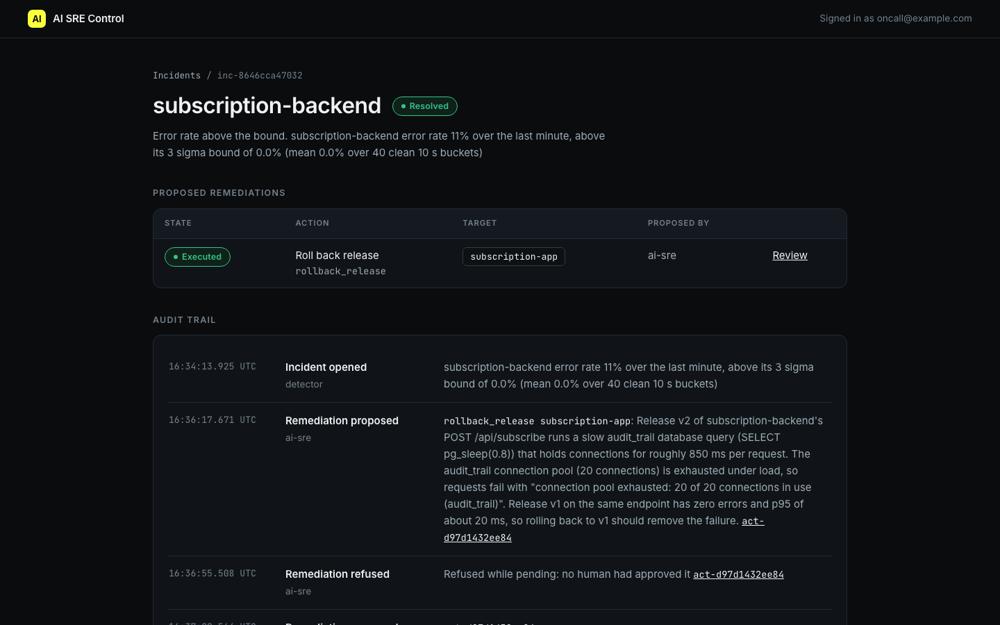

# AI SRE Workshop: an agent that finds the cause and waits for your approval

You run a small web app on your laptop, with full telemetry in ClickStack. Then you break it on purpose, and a detector opens an incident.

An AI SRE agent reads the telemetry with the SQL you write. It finds the cause and proposes one fix. Nothing runs until you approve it. Every step lands in an audit log you can query.

You can work through it alone, at your own pace. Each lesson has a picture of the idea, the exact commands, what you should see, and a screenshot.



## Run it

You need Docker with about 8 GB of memory, `make`, `uv` and an Anthropic API key.

```bash
cp .env.example .env
make env
```

Expect: ClickStack starts alone and the command asks for the HyperDX ingestion key.

Open http://localhost:8080, make a HyperDX account, and copy the ingestion key from Team Settings. Put it and your Anthropic key in `.env` with your editor, never on a command line. Then start everything:

```bash
make up
```

Expect: every service turns healthy, and the command creates the workshop logins.

[Set up the lab](./docs/learner/00-setup.md) walks through each step with screenshots.

## Lessons

| Lesson | What you do |
| --- | --- |
| [Set up the lab](./docs/learner/00-setup.md) | Start the stack, add your keys, make a signup and find it in HyperDX. |
| [Read the raw data](./docs/learner/01-substrate.md) | Count spans and failed spans for each service. |
| [Spot an odd minute](./docs/learner/02-anomaly.md) | Turn spans into an error rate for each time bucket. |
| [Find what changed](./docs/learner/03-event-deltas.md) | Find the log patterns that are new in the incident. |
| [Open one request](./docs/learner/04-trace-graph.md) | List the worst requests and read one waterfall. |
| [Measure the budget burn](./docs/learner/05-slo-burn.md) | Work out how fast the error budget burns. |
| [Run a live incident](./docs/learner/06-live-incident.md) | Break the app, let the agent investigate, approve the fix. |

Each SQL lesson has one `TODO` in `workshop/exercises/`. `make exercise N=1` to `N=5` checks your answer against the solution. The [walkthrough](./docs/walkthrough.md) explains every idea the lessons use.

## What runs

| Service | What it is | Port |
|---|---|---|
| `clickstack` | ClickHouse, the HyperDX UI and an OpenTelemetry collector | 8080, plus 4317 and 4318 for OTLP |
| `subscription-app` | The Flask signup page. It ships as a good `v1` and a faulty `v2`. Its footer shows the release. | 8000 |
| `postgres-db` | Postgres, with the `users` table the form writes to | inside only |
| `docs-loader` | A Go service behind `/load-docs`, with a handler that can hang | inside only |
| `traffic` | Steady page views and signups, so every signal has a baseline | none |
| `sre-control` | The detector, incidents, approvals, the SRE tools and the runner | 8090 |
| `mcp-clickhouse` | ClickHouse's MCP server, for read-only SQL | inside only |
| `librechat` and `mongodb` | The chat where the agent works, on `claude-haiku-5-5` | 3080 |
| `otel-collector` and `socat` | Container CPU and memory stats | none |
| `load-generator` | Optional browser traffic, under the `browser-load` profile | none |

Every part reports to ClickStack, the agent included. You can follow one click on the page all the way to the database write.

## What the agent may do

| Tool | Kind | Server |
|---|---|---|
| `list_sources`, `service_timeseries`, `analyze_service_anomalies`, `get_event_deltas`, `event_patterns`, `get_trace_waterfall`, `search_logs`, `slo_burn`, `list_incidents`, `get_incident`, `get_remediation_status` | read | sre-control |
| `run_query`, `list_databases`, `list_tables` | read, as the ClickHouse user `sre_agent` | mcp-clickhouse |
| `propose_remediation` | stores a proposal that waits | sre-control |
| `execute_remediation` | runs `rollback_release` or `restart_service`, only after a human approves | sre-control |

The `sre_agent` user cannot write. ClickHouse also caps each of its queries at 10 seconds, 1 GB of memory and 10,000 rows. Every tool has a kind in `sre-control/sre_control/policy.py`, and a test fails if one is missing.

The runner builds each command from a fixed list of two actions. It never runs text the model wrote.

## The SQL you write is the SQL the agent runs

`workshop/` holds the queries as named blocks. sre-control loads the same blocks for its tools. So a query you fix in a lesson also fixes the agent.

| File | Lesson |
|---|---|
| `workshop/01-substrate.sql` | Read the raw data |
| `workshop/02-anomaly.sql` | Spot an odd minute |
| `workshop/03-event-deltas.sql` | Find what changed |
| `workshop/04-trace-graph.sql` | Open one request |
| `workshop/05-slo-burn.sql` | Measure the budget burn |

## Checks

| Command | What it proves |
|---|---|
| `make check` | Lint, prose, plain English in the lessons, unit and structure tests. It needs no Docker and no model. CI runs it on every push. |
| `make e2e` | The full stack with the real model and a real browser, from signup to a resolved incident. It writes the screenshots in `evidence/screens`. |
| `make score` | A score out of 100 from the latest `check` and `e2e` results. Below 100 exits 1. |

## Run it on a server

`docker-compose.vps.yml` puts Caddy in front with TLS and opens only ports 80 and 443. Point five DNS names at the server: `app`, `otlp`, `hyperdx`, `chat` and `sre`, each under your domain. Set `PUBLIC_DOMAIN` in `.env`, then run:

```bash
make env
make up-vps
```

Expect: the same stack, reached through your five names over HTTPS.

`make check` checks this setup by its structure only. It has not yet run on a live server.

## Where this came from

The lab started from ClickHouse's [clickstack-demo-subscription-app](https://github.com/ClickHouse/clickstack-demo-subscription-app), under the Apache 2.0 license in `LICENSE`. The agent workspace follows ClickHouse's [agentic-data-stack](https://github.com/ClickHouse/agentic-data-stack). The tools follow [ClickStack's AI SRE tools](https://clickhouse.com/clickstack/ai-sre-observability).
