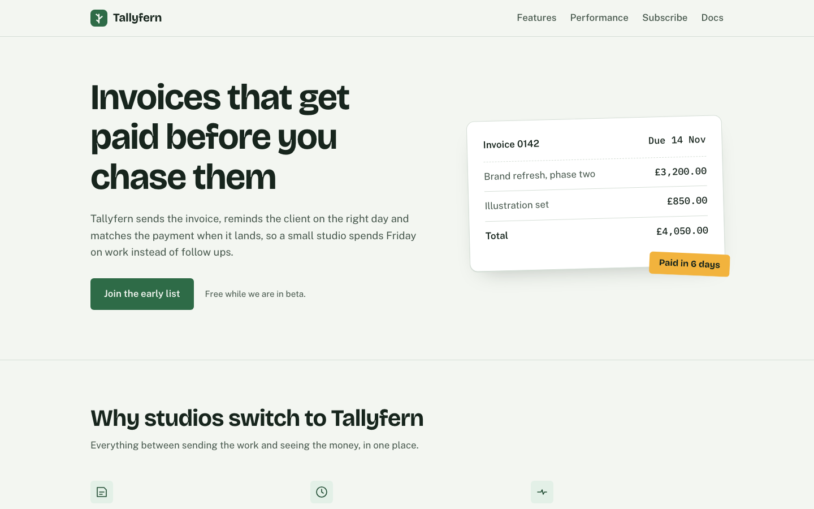
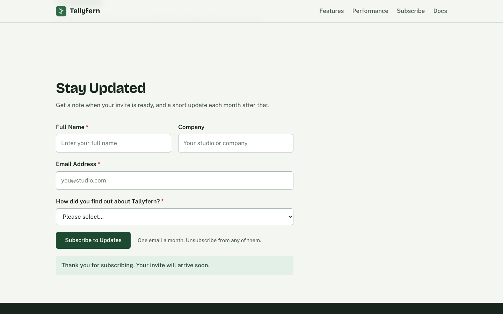
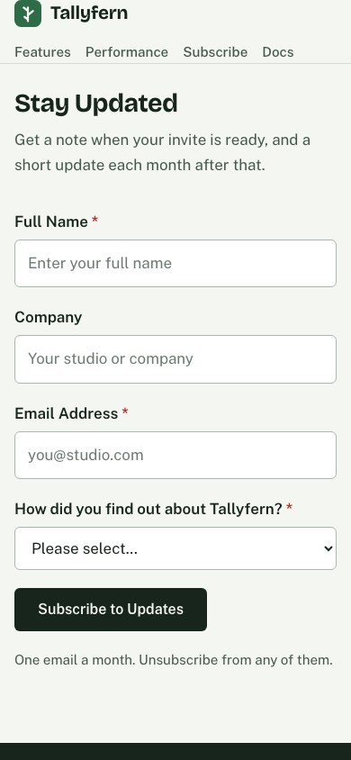
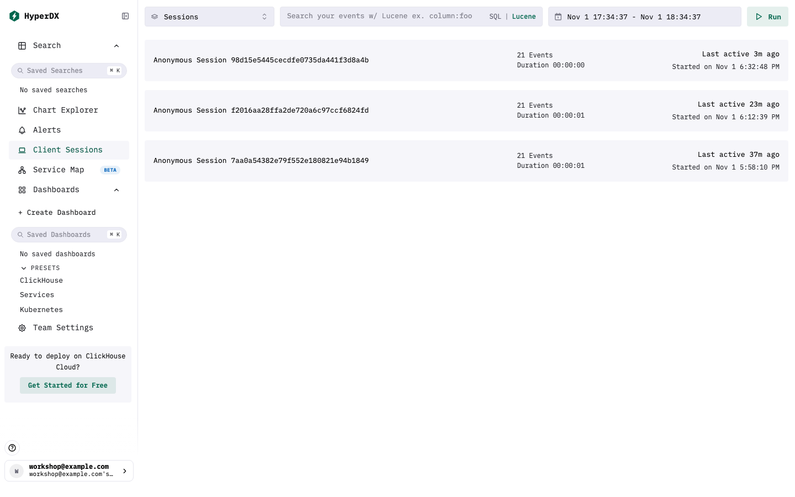

# 00 Set up the lab

## Why a lab of your own

An AI SRE is only as good as the data it reads. So you run a small, real system on your laptop. It has a signup app, a store for every signal, and an agent that reads that store. Every lesson reads the same data.

Complementary materials:

- Docs: [ClickStack overview](https://clickhouse.com/docs/use-cases/observability/clickstack/overview). The store and the HyperDX screens you use in this lab.
- Docs: [OpenTelemetry concepts](https://opentelemetry.io/docs/concepts/). How an app sends its spans and logs.
- Book: [Monitoring distributed systems](https://sre.google/sre-book/monitoring-distributed-systems/). The Google SRE book chapter on what to watch.

## Goal

The whole stack runs on your laptop. You can open each page, make a signup, and find your own visit in HyperDX.

## Before

A team runs a signup page called Tallyfern. One morning, a new release makes signups slow and some fail. Nobody sees it for an hour. When someone looks, they open four tools and guess.

This lab is the fix for that morning. It has five parts that talk to each other.


1. **The product.** The signup app, a small Go service and Postgres.
2. **Fake users.** A load generator signs up all day, so there is always traffic.
3. **ClickStack.** A collector takes every span and log line. ClickHouse keeps them. HyperDX shows them.
4. **The AI SRE.** A detector opens incidents. The agent reads ClickHouse with a read only user.
5. **You.** Only your approval lets the agent change anything.

You start all of it in four steps.

## Starting point

You need Docker with about 8 GB of memory for it, `make`, and an Anthropic API key. Clone this repo and open a terminal in it.

## Step 1: Make the secrets

Copy the example file, then let the lab fill in every secret it can make for itself.

```bash
cp .env.example .env
make env
```

Expect: `make env` starts ClickStack alone and tells you to copy the ingestion key from HyperDX.

**Verify:** `.env` now ends with a part called `# Generated by make env`. It holds long random values for the ClickHouse users and the page logins.

## Step 2: Add your two keys

Open http://localhost:8080 and create a HyperDX account. Go to Team Settings and copy the ingestion API key.

Open `.env` in your editor. Put the two keys only you can supply on these lines:

```bash
HYPERDX_API_KEY=<your ingestion key>
ANTHROPIC_API_KEY=<your Anthropic key>
```

Expect: both lines in `.env` hold a value. The file is ignored by git.

Type keys into the file, never onto a command line. A command line ends up in your shell history.

**Verify:** run `git status`. The file `.env` is not in the list.

## Step 3: Start everything

```bash
make up
```

Expect: the command waits until every service is healthy, then prints one line for the LibreChat user and one for the HyperDX user.

Open the four pages. The logins are in `.env`.

| Page | Address | Login |
|---|---|---|
| Signup app | http://localhost:8000 | none |
| HyperDX | http://localhost:8080 | your account |
| AI SRE Control | http://localhost:8090 | `SRE_APPROVER_EMAIL` |
| LibreChat | http://localhost:3080 | `LIBRECHAT_USER_EMAIL` |

If another project holds port 3080, run `CHAT_PORT=3081 make up` and use port 3081.

**Verify:** run `make ps`. Every service says healthy or running.

## Step 4: Make one signup

Open the signup app. It is Tallyfern, a small invoicing product with an early list. This is the page the fake users hit all day.



Click **Join the early list**. Fill in the form and click **Subscribe to Updates**.



The same form works on a phone. Real users come from both, so a slow page hurts on both.



**Verify:** a green thank you note shows in under a second.

## Use it

Open HyperDX and choose **Client Sessions**. Each row is one visit to the app from a browser. The fake users show up here too, so the list is never empty.



Click your session. You see each click and each request it made. This is the same data the agent will read later, just shown as a page.

## How to verify you are done

- `make ps` shows every service healthy.
- The four pages open, and you can sign in to each one that needs a login.
- Your signup shows a green thank you note.
- HyperDX lists a session that started a moment ago.

## Wrap-up

You run the same shape a real team runs: an app, a collector, one store for every signal, and a person in charge. Each lesson after this one adds one query to that store. In the last lesson the agent runs your queries during a live incident.

`make down` stops the stack and keeps your data. `make chaos-reset` undoes any failure you put in.

## If you get stuck

- Run `make ps` to see which service is not healthy.
- Run `make logs SERVICE=sre-control` to read the logs of one service.
- The [walkthrough](../walkthrough.md#the-stack) draws every service and how they talk.

## Next

[Read the raw data](01-substrate.md).
