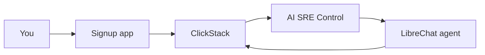

# Set up the lab

## Why a lab of your own

An AI SRE is only as good as the data it reads. So you run a small, real system on your own laptop. It has a signup app, a telemetry store and an agent. Every lesson reads the same data.

## Goal

The whole stack runs on your laptop. You can open each page and see your own signup as a trace.

## Starting point

You need Docker with about 8 GB of memory for it, `make`, and an Anthropic API key.



## Make the secrets

Copy the example file, then let the lab fill in every secret it can make for itself.

```bash
cp .env.example .env
make env
```

Expect: `make env` starts ClickStack alone and tells you to copy the ingestion key from HyperDX.

## Add your two keys

Open http://localhost:8080 and create a HyperDX account. Go to Team Settings and copy the ingestion API key.

Open `.env` in your editor. Put the two keys only you can supply on these lines:

```bash
HYPERDX_API_KEY=<your ingestion key>
ANTHROPIC_API_KEY=<your Anthropic key>
```

Expect: both lines in `.env` hold a value. The file is ignored by git.

Type keys into the file, never onto a command line. A command line ends up in your shell history.

## Start everything

```bash
make up
```

Expect: the command waits until every service is healthy, then prints one line for the LibreChat user and one for the HyperDX user.

Open the four pages. The logins are in `.env`.

| Page | Address | Login |
|---|---|---|
| Signup app | http://localhost:8000 | none |
| HyperDX | http://localhost:8080 | your account |
| AI SRE Control | http://localhost:8090 | `SRE_APPROVER_EMAIL` |
| LibreChat | http://localhost:3080 | `LIBRECHAT_USER_EMAIL` |

If another project holds port 3080, run `CHAT_PORT=3081 make up` and use port 3081.

## Make one signup

Open the signup app. It is Tallyfern, a small invoicing product with an early list.


Click **Join the early list**. Fill in the form and click **Subscribe to Updates**.


Expect: a green thank you note shows in under a second.

## Find your visit

Open HyperDX and choose **Client Sessions**. Each row is one visit to the app from a browser.


Expect: a session that started a moment ago.

## Stop and reset

`make down` stops the stack and keeps your data. `make chaos-reset` undoes any failure you put in.

## If you get stuck

- Run `make ps` to see which service is not healthy.
- Run `make logs SERVICE=sre-control` to read the logs of one service.
- The [walkthrough](../walkthrough.md#the-stack) draws every service and how they talk.

## Next

[Read the raw data](01-substrate.md).
