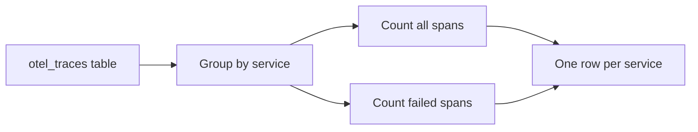
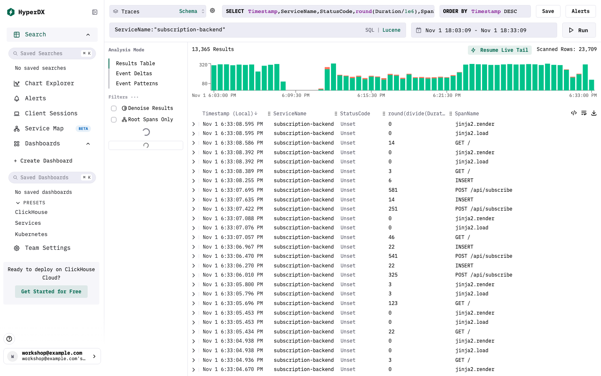

# Read the raw data

## Why start with the raw data

The agent can only find a cause that is in the data. So before you trust it, look at what the data holds. Every span the app sends lands in one ClickHouse table, `otel_traces`.

## Goal

You can say which services report, how many spans each sends, and how many of those spans failed.

## Starting point

The stack is up from [Set up the lab](00-setup.md), and you made at least one signup.



## See the spans

Open HyperDX at http://localhost:8080 and choose **Search**. Pick the **Traces** source. Each row is one span: one piece of work inside a request.



Look at the **StatusCode** column. Most spans say `Unset`. A failed span says `Error`.

## Run the check first

```bash
make exercise N=1
```

Expect: `01-substrate.sql: the TODO in list_services is still there`.

That failure is on purpose. It shows you which file to open.

## Fill in the TODO

Open `workshop/exercises/01-substrate.sql`. Find this line:

```sql
countIf(TODO) AS error_spans,
```

`countIf` counts only the rows where its condition is true. Write the condition that marks a failed span. Use the **StatusCode** column you saw in HyperDX.

Run the check again.

```bash
make exercise N=1
```

Expect: `match: list_services returns the same N row(s) as the solution`, where N is the number of services.

## What you learned

- One table holds every span, from every service. Read more on [wide events](../walkthrough.md#c-wide-event).
- A count of failed spans is the first signal of trouble. Read more on [signals](../walkthrough.md#c-signals).

## If you get stuck

If the check prints `differ:`, compare the `yours:` row with the `solution:` row. The answer is the `list_services` block in [workshop/01-substrate.sql](../../workshop/01-substrate.sql).

## Next

[Spot an odd minute](02-anomaly.md).
