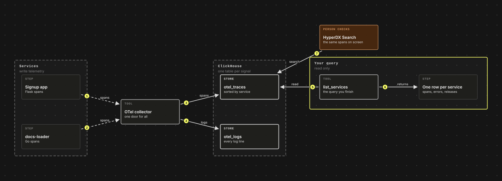

# 01 Read the raw data

## Why start with the raw data

The agent can only find a cause that is in the data. So before you trust it, look at what the data holds. Every span the app sends lands in one ClickHouse table, `otel_traces`.

Complementary materials:

- Docs: [Traces](https://opentelemetry.io/docs/concepts/signals/traces/). What a span is, and how spans make up one trace.
- Docs: [MergeTree](https://clickhouse.com/docs/engines/table-engines/mergetree-family/mergetree). Why a table sorted by service and time reads one service fast.
- Docs: [Aggregate function combinators](https://clickhouse.com/docs/sql-reference/aggregate-functions/combinators). How `countIf` counts only the rows you want.

## Goal

You can say which services report, how many spans each sends, and how many of those spans failed.

## Before

A signup feels slow. You open the logs of the signup app and scroll. The slow part is in the Go service, so its logs live somewhere else. You never see both at once, and you cannot count anything.



In this lab, both services send to one place:

1. **Each service sends spans.** A span is one small job, such as a database insert.
2. **One table per signal.** Spans go to `otel_traces`, log lines go to `otel_logs`.
3. **One query answers the question.** Group the spans by service and count.

## Starting point

The stack is up from [Set up the lab](00-setup.md), and you made at least one signup. You edit one file: `workshop/exercises/01-substrate.sql`.

## Step 1: See the spans

Open HyperDX at http://localhost:8080 and choose **Search**. Pick the **Traces** source. Each row is one span: one piece of work inside a request.


Read the screen from the top:

- The search box filters on `ServiceName`. The signup app reports as `subscription-backend`.
- The bar chart counts spans over time. A red top on a bar means some spans failed.
- Each row names one span, such as `POST /api/subscribe` or `INSERT`. A request is one span with smaller ones inside it.
- The **StatusCode** column says `Unset` for a good span and `Error` for a failed one.

**Verify:** you can find a `POST /api/subscribe` span from your own signup.

## Step 2: Run the check first

```bash
make exercise N=1
```

Expect: `01-substrate.sql: the TODO in list_services is still there`.

That failure is on purpose. It shows you which file to open.

**Verify:** the check names `list_services`, the query you finish next.

## Step 3: Fill in the TODO

Open `workshop/exercises/01-substrate.sql`. Find this line:

```sql
countIf(TODO) AS error_spans,
```

`countIf` counts only the rows where its condition is true. Write the condition that marks a failed span. Use the **StatusCode** column you saw in HyperDX.

Run the check again.

```bash
make exercise N=1
```

Expect: `match: list_services returns the same N row(s) as the solution`, where N is the number of services.

**Verify:** the check prints `match:`. Your query runs as the same read only user the agent uses.

## Use it

Your query also lists the releases each service runs. Look at the `releases` column for `subscription-backend`. Today it says `v1`. In the live incident, `v2` shows up next to it, and that is the first clue.

The same file has two more blocks the agent uses. `list_tables` shows how big each table is. `latency_percentiles` shows how slow each endpoint is.

## How to verify you are done

- HyperDX shows spans for `subscription-backend`, each with a StatusCode.
- `make exercise N=1` prints `match:`.
- You can say what one row of `list_services` means.

## Wrap-up

One table holds every span from every service. The table is sorted by service, then time. So a query about one service reads a small part of it. Read more on [wide events](../walkthrough.md#c-wide-event) and [signals](../walkthrough.md#c-signals).

## If you get stuck

If the check prints `differ:`, compare the `yours:` row with the `solution:` row. The answer is the `list_services` block in [workshop/01-substrate.sql](../../workshop/01-substrate.sql).

## Next

[Spot an odd minute](02-anomaly.md).
