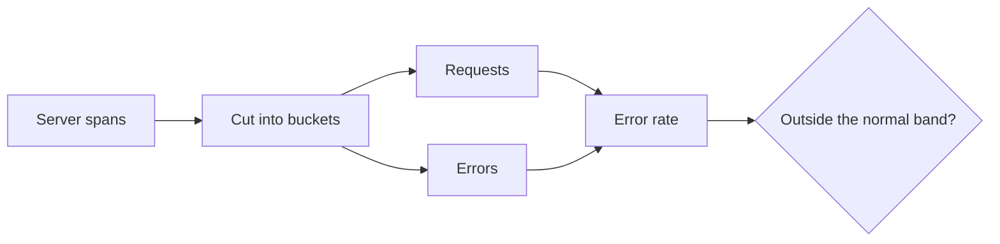

# Spot an odd minute

## Why look at rates

A count of errors grows when traffic grows. A rate does not. So the question is not "how many errors". It is "what share of requests failed in each small window".

## Goal

You can turn spans into one row per time bucket, with requests, errors and the error rate.

## Starting point

You finished [Read the raw data](01-substrate.md).



## Fill in the TODO

Open `workshop/exercises/02-anomaly.sql`. Find this line:

```sql
round(TODO, 4) AS error_rate,
```

The two lines before it already name `requests` and `errors`. The error rate is errors divided by requests. ClickHouse lets you use a name from the same `SELECT`.

```bash
make exercise N=2
```

Expect: `match: service_timeseries returns the same N row(s) as the solution`, where N is the number of buckets.

## How the lab finds an odd minute

The detector in the lab uses this same rate. It learns the normal band from earlier buckets. Then it checks if the last minute sits more than three sigma over the mean. The agent runs the same rule with the `analyze_service_anomalies` block in the same file.

The band leaves out the minutes of past incidents. If it did not, one bad hour would teach the detector that errors are normal.

## What you learned

- A rate is fair across busy and quiet times. Read more on the [baseline](../walkthrough.md#c-baseline).
- The three sigma rule says how far is too far. Read more on [three sigma](../walkthrough.md#c-three-sigma).

## If you get stuck

The answer is the `service_timeseries` block in [workshop/02-anomaly.sql](../../workshop/02-anomaly.sql).

## Next

[Find what changed](03-event-deltas.md).
