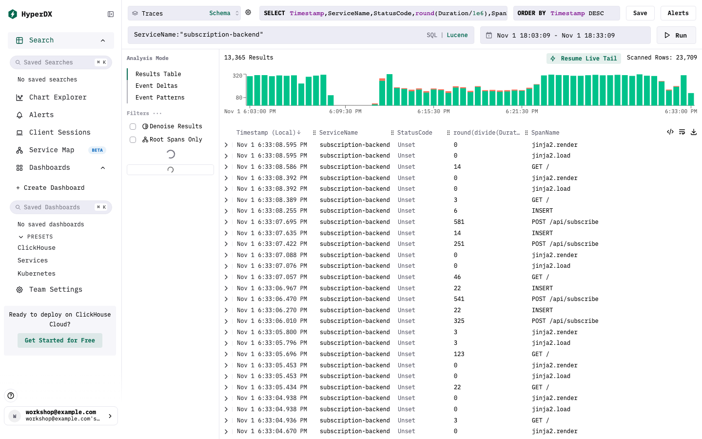
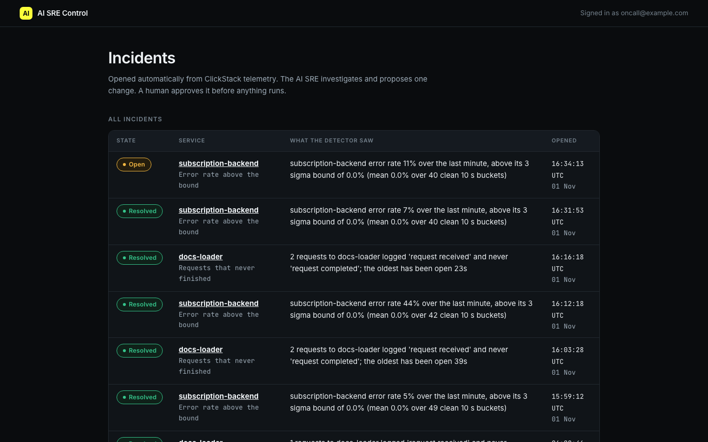

# 02 Spot an odd minute

## Why look at rates

A count of errors grows when traffic grows. A rate does not. So the question is not "how many errors". It is "what share of requests failed in each small window".

Complementary materials:

- Book: [Monitoring distributed systems](https://sre.google/sre-book/monitoring-distributed-systems/). The four golden signals, and why errors and time come first.
- Docs: [Incremental materialized views](https://clickhouse.com/docs/materialized-view/incremental-materialized-view). How the lab keeps a rate per minute ready before anyone asks.
- Docs: [toStartOfInterval](https://clickhouse.com/docs/sql-reference/functions/date-time-functions#tostartofinterval). How a query cuts time into buckets.

## Goal

You can turn spans into one row per time bucket, with requests, errors and the error rate.

## Before

A team sets an alert: page when there are more than 50 errors a minute. At night, traffic is low, so half the signups can fail and nobody is paged. In the day, a busy minute pages them for nothing. The count was the wrong signal.


The lab does it with rates:

1. **Cut time into buckets.** In each one, divide errors by requests.
2. **Learn what normal looks like.** Older buckets give a mean and a spread.
3. **Test the last minute.** It must pass the mean plus three sigma, and sit at least 5 points over the mean.
4. **Open an incident.** The detector runs every 10 seconds and opens one when both tests fail.

## Starting point

You finished [Read the raw data](01-substrate.md). You edit `workshop/exercises/02-anomaly.sql`.

## Step 1: Fill in the TODO

Open `workshop/exercises/02-anomaly.sql`. Find this line:

```sql
round(TODO, 4) AS error_rate,
```

The two lines before it already name `requests` and `errors`. The error rate is errors divided by requests. ClickHouse lets you use a name from the same `SELECT`.

```bash
make exercise N=2
```

Expect: `match: service_timeseries returns the same N row(s) as the solution`, where N is the number of buckets.

**Verify:** the check prints `match:`. Each row is one bucket, oldest first.

## Step 2: See the buckets on screen

Go back to HyperDX Search on the Traces source. The bar chart is the same idea as your query. Each bar is a bucket of time.



A red top is the errors in that bucket. A tall bar with a thin red top is a busy, healthy bucket. A short bar that is half red is a quiet bucket in trouble. Your rate tells those two apart. The bar height alone does not.

**Verify:** you can point at a bar and say if its rate is high or low.

## Step 3: Read how the detector decides

The detector uses this same rate. Open the `analyze_service_anomalies` block in [workshop/02-anomaly.sql](../../workshop/02-anomaly.sql) and find these parts:

- `baseline_mean` and `baseline_sigma` come from the buckets before the last minute.
- `bound` is the mean plus three sigma.
- `anomalous` is true only when the last minute is over the bound and also `min_delta` over the mean.

The floor matters. A service with no errors at all has a sigma of zero. Without the floor, one failed signup would open an incident.

The band also leaves out the minutes of past incidents. If it did not, one bad hour would teach the detector that errors are normal.

**Verify:** you can say why a quiet service needs the floor.

## Use it

Open AI SRE Control at http://localhost:8090. Each incident states what the detector saw, in the words of this lesson.



Read the open one: an 11 percent error rate, a bound of 0.0 percent, and a mean over 40 clean buckets. "Clean" means the buckets of past incidents were left out.

## How to verify you are done

- `make exercise N=2` prints `match:`.
- You can name the two tests the last minute must fail.
- You can read an incident line and say what the mean, the bound and the buckets mean.

## Wrap-up

A rate is fair across busy and quiet times. The three sigma band says how far is too far, and the floor stops a page for one error. The lab also keeps a rate per minute in a materialized view, `service_minute`, so a whole day reads fast. Read more on the [baseline](../walkthrough.md#c-baseline), [three sigma](../walkthrough.md#c-three-sigma) and [leaving out incidents](../walkthrough.md#c-incident-exclusion).

## If you get stuck

The answer is the `service_timeseries` block in [workshop/02-anomaly.sql](../../workshop/02-anomaly.sql).

## Next

[Find what changed](03-event-deltas.md).
