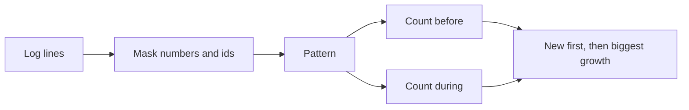

# Find what changed

## Why compare two windows

A failing service writes many log lines. Most of them also show up on a good day. The line that matters is the one that is new. So you compare the incident window with the same stretch of time just before it.

## Goal

You can mark each log pattern as new or old, and rank the new ones first.

## Starting point

You finished [Spot an odd minute](02-anomaly.md).



## How a pattern works

A pattern is a log line with its numbers, ids, emails and times replaced. So `pool exhausted: 20 of 20` becomes `pool exhausted: N of N`. Ten thousand lines fold into a few shapes you can read.

## Fill in the TODO

Open `workshop/exercises/03-event-deltas.sql`. Find this line:

```sql
TODO AS is_new,
```

The query already counts `incident` and `baseline` for each pattern. A pattern is new when it shows up in the incident window and never in the baseline.

```bash
make exercise N=3
```

Expect: `match: get_event_deltas returns the same N row(s) as the solution`, where N is the number of patterns.

## What you learned

- New beats loud. A new pattern points at the cause. Read more on [event deltas](../walkthrough.md#c-event-delta).
- Masking makes lines you can count. Read more on [log patterns](../walkthrough.md#c-log-pattern).

## If you get stuck

The answer is the `get_event_deltas` block in [workshop/03-event-deltas.sql](../../workshop/03-event-deltas.sql).

## Next

[Open one request](04-trace-graph.md).
