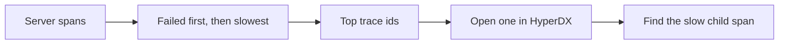
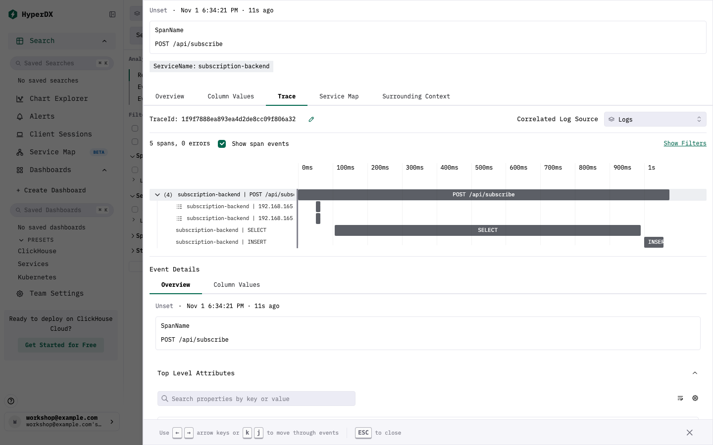

# Open one request

## Why open a single trace

A rate tells you something is wrong. One trace tells you where. The agent must cite trace ids, so each claim it makes is a request you can open and check.

## Goal

You can list the worst requests first, then open one and read its waterfall.

## Starting point

You finished [Find what changed](03-event-deltas.md).



## Fill in the TODO

Open `workshop/exercises/04-trace-graph.sql`. Find this line:

```sql
ORDER BY TODO
```

You want two keys. First, failed spans come before good ones. Then, the slowest come first. The status is in `StatusCode` and the time is in `Duration`.

```bash
make exercise N=4
```

Expect: `match: sample_error_traces returns the same N row(s) as the solution`, where N is the number of traces.

## Read a waterfall

Copy one trace id. In HyperDX, search for it and open the **Trace** tab. Each bar is one span. A long bar under a short parent is where the time went.



In this trace, the `SELECT` span takes most of the request. That is the clue the agent follows in the live incident.

## What you learned

- Evidence is a trace id you can open. Read more on [grounding](../walkthrough.md#c-grounding).
- A waterfall shows where the time went. Read more on the [trace graph](../walkthrough.md#c-trace-graph).

## If you get stuck

The answer is the `sample_error_traces` block in [workshop/04-trace-graph.sql](../../workshop/04-trace-graph.sql).

## Next

[Measure the budget burn](05-slo-burn.md).
