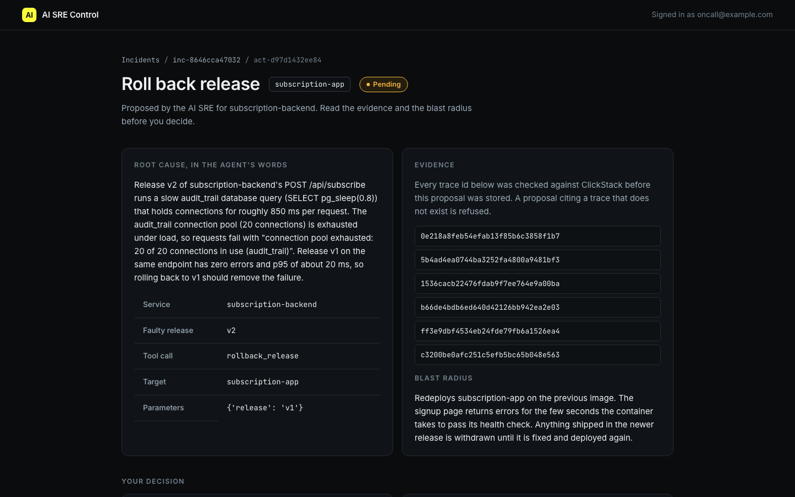

# 04 Open one request

## Why open a single trace

A rate tells you something is wrong. One trace tells you where. The agent must cite trace ids, so each claim it makes is a request you can open and check.

Complementary materials:

- Docs: [Traces](https://opentelemetry.io/docs/concepts/signals/traces/). Parent and child spans, and how a waterfall is drawn.
- Docs: [Search in ClickStack](https://clickhouse.com/docs/use-cases/observability/clickstack/search). How to find one trace and open its waterfall.
- Guide: [Building effective agents](https://www.anthropic.com/engineering/building-effective-agents). Why an agent's work needs checks it cannot skip.

## Goal

You can list the worst requests first, then open one and read its waterfall.

## Before

The agent says "the database is slow" and sounds sure. You have no way to check. Maybe it read the right rows. Maybe it made up a smooth story. You approve, and nothing gets better.


A claim must come with proof you can open:

1. **Pick the worst requests.** Failed first, then the slowest.
2. **Read one waterfall.** Find the span that holds the time.
3. **Cite the ids.** The agent's proposal lists the trace ids behind it.
4. **Check every id.** The server looks each one up before it stores the plan.

## Starting point

You finished [Find what changed](03-event-deltas.md). You edit `workshop/exercises/04-trace-graph.sql`.

## Step 1: Fill in the TODO

Open `workshop/exercises/04-trace-graph.sql`. Find this line:

```sql
ORDER BY TODO
```

You want two keys. First, failed spans come before good ones. Then, the slowest come first. The status is in `StatusCode` and the time is in `Duration`.

```bash
make exercise N=4
```

Expect: `match: sample_error_traces returns the same N row(s) as the solution`, where N is the number of traces.

**Verify:** the check prints `match:`. Each row has a `trace_id` you can open.

## Step 2: Read a waterfall

Copy one trace id. In HyperDX, search for it and open the **Trace** tab. Each bar is one span. A long bar under a short parent is where the time went.


Read it from the top. `POST /api/subscribe` is the whole request, about one second. Under it, a `SELECT` span runs from about 100 ms to 950 ms. The `INSERT` after it is short. So the signup spends most of its time waiting on one query.

The agent reads the same tree with `get_trace_waterfall` in [workshop/04-trace-graph.sql](../../workshop/04-trace-graph.sql).

**Verify:** you can name the span that holds most of the time.

## Step 3: See how ids are checked

Open the `trace_window` block in the same file. When the agent proposes a fix, sre-control runs it for each cited id. The proposal is refused when:

- it cites no trace id at all,
- an id has no spans in ClickHouse,
- a trace started well before the incident opened,
- a trace never touched the service in the incident.

These checks run on the server. A prompt cannot turn them off.

**Verify:** you can name one reason a proposal is refused.

## Use it

When a proposal passes, the approval page lists each trace id and says it was checked.



Open one of the ids in HyperDX. It shows the same slow `SELECT` you read in Step 2. That is what grounded means: a claim you can open and check yourself.

## How to verify you are done

- `make exercise N=4` prints `match:`.
- You opened one trace and found its slowest span.
- You can say what the server checks before it stores a proposal.

## Wrap-up

Evidence is a trace id you can open. The waterfall shows where the time went, and the server checks every id before a human ever sees the plan. Read more on [grounding](../walkthrough.md#c-grounding) and the [trace graph](../walkthrough.md#c-trace-graph).

## If you get stuck

The answer is the `sample_error_traces` block in [workshop/04-trace-graph.sql](../../workshop/04-trace-graph.sql).

## Next

[Measure the budget burn](05-slo-burn.md).
