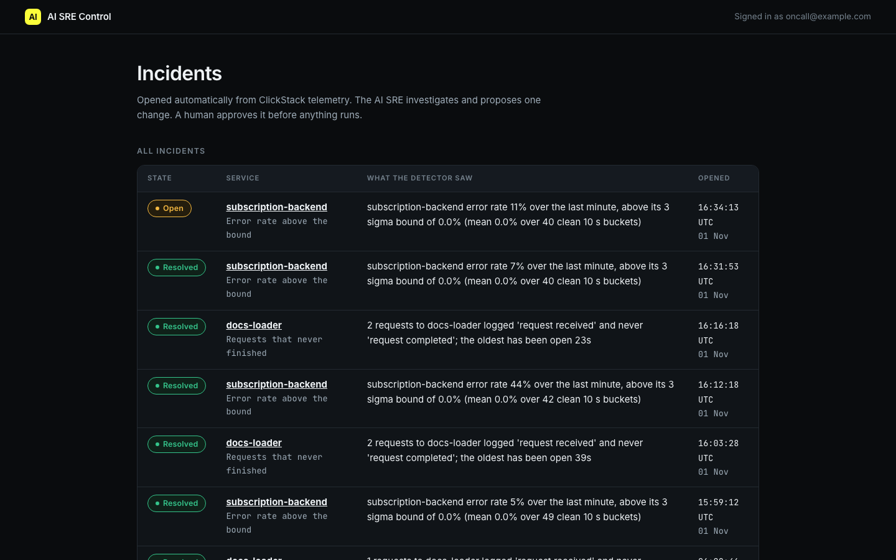

# 05 Measure the budget burn

## Why a burn rate

A promise like "99.5 percent of signups work" leaves a small budget for failure. Half a percent of requests may fail. The burn rate says how fast you spend that budget. A burn rate of 1 spends it right on time. A burn rate of 14 spends a month of budget in about two days.

Complementary materials:

- Book: [Service level objectives](https://sre.google/sre-book/service-level-objectives/). What an SLO is and how to pick one.
- Workbook: [Alerting on SLOs](https://sre.google/workbook/alerting-on-slos/). Burn rates and the short and long window rule this lesson uses.
- Workbook: [Implementing SLOs](https://sre.google/workbook/implementing-slos/). How a team agrees on a target and an error budget policy.

## Goal

You can work out the burn rate of the last hour for one service, and read it next to the last six hours.

## Before

The team pages on any error rate over 1 percent. A two minute blip at 3 a.m. wakes someone up, and it is over before they log in. A slow leak at 0.8 percent never pages, and it eats the whole month of budget. The alert watched size, not speed.


The burn rate fixes both:

1. **A promise becomes a budget.** 99.5 percent leaves 0.5 percent that may fail.
2. **Two windows.** The error rate of the last hour and of the last six hours, each divided by the budget.
3. **Read them together.** Both high is a real burn. Only the hour high is a blip.

## Starting point

You finished [Open one request](04-trace-graph.md). You edit `workshop/exercises/05-slo-burn.sql`.

## Step 1: Fill in the TODO

Open `workshop/exercises/05-slo-burn.sql`. Find this line:

```sql
round(TODO, 2) AS burn_1h,
```

The query names `budget` and `in_1h` for you. Count the failed requests in the last hour. Divide by the requests in the last hour. Then divide by the budget.

Use `greatest(requests_1h, 1)` as the bottom of the first division. Then a quiet hour does not divide by zero.

```bash
make exercise N=5
```

Expect: `match: slo_burn returns the same N row(s) as the solution`, where N is 1 if the app had traffic in the last six hours.

**Verify:** the check prints `match:`. Your `burn_1h` sits next to `burn_6h` in the row.

## Step 2: Work one out by hand

Say the last hour had 2,000 signups and 30 failed. The error rate is 30 over 2,000, which is 1.5 percent. The budget is 0.5 percent. So the burn rate is 3. At that speed, a month of budget lasts about ten days.

**Verify:** you get a burn rate of 3 from those numbers.

## Step 3: Read both windows

The same query also works out `burn_6h`. Read both together:

| burn_1h | burn_6h | What it means |
|---|---|---|
| High | High | A real burn that is still going. Act now. |
| High | Low | A short blip. Watch it, do not wake anyone. |
| Low | High | It was bad and has stopped. Look at it in the day. |

**Verify:** you can say which row should page a person.

## Use it

Each incident on the control page spent some of the budget. A fast fix spends less.



An 11 percent error rate is a burn rate of 22. At that speed, the month of budget is gone in less than a day and a half. That is why the next lesson is about acting fast, with a human still in charge.

## How to verify you are done

- `make exercise N=5` prints `match:`.
- You can turn an error rate into a burn rate.
- You can read `burn_1h` and `burn_6h` together and say if it should page.

## Wrap-up

A target turns into a budget, and speed matters more than size. Two windows tell a real burn from a blip. Read more on the [SLO](../walkthrough.md#c-slo), the [error budget](../walkthrough.md#c-error-budget) and the [burn rate](../walkthrough.md#c-burn-rate).

## If you get stuck

The answer is the `slo_burn` block in [workshop/05-slo-burn.sql](../../workshop/05-slo-burn.sql).

## Next

[Run a live incident](06-live-incident.md).
