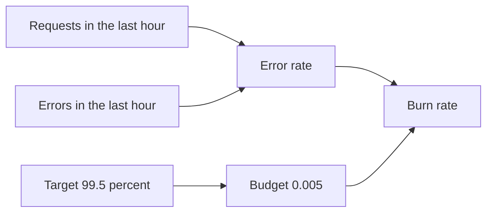

# Measure the budget burn

## Why a burn rate

A promise like "99.5 percent of signups work" leaves a small budget for failure. Half a percent of requests may fail. The burn rate says how fast you spend that budget. A burn rate of 1 spends it right on time. A burn rate of 14 spends a month of budget in about two days.

## Goal

You can work out the burn rate of the last hour for one service.

## Starting point

You finished [Open one request](04-trace-graph.md).



## Fill in the TODO

Open `workshop/exercises/05-slo-burn.sql`. Find this line:

```sql
round(TODO, 2) AS burn_1h,
```

The query names `budget` and `in_1h` for you. Count the failed requests in the last hour. Divide by the requests in the last hour. Then divide by the budget.

Use `greatest(requests_1h, 1)` as the bottom of the first division. Then a quiet hour does not divide by zero.

```bash
make exercise N=5
```

Expect: `match: slo_burn returns the same N row(s) as the solution`, where N is 1 if the app had traffic in the last six hours.

## Short and long windows

The same query also works out `burn_6h`. Read both together. If both are high, the burn is real and still going. If only the short one is high, it was a blip that has stopped.

## What you learned

- A target turns into a budget. Read more on the [SLO](../walkthrough.md#c-slo) and the [error budget](../walkthrough.md#c-error-budget).
- Speed matters more than size. Read more on the [burn rate](../walkthrough.md#c-burn-rate).

## If you get stuck

The answer is the `slo_burn` block in [workshop/05-slo-burn.sql](../../workshop/05-slo-burn.sql).

## Next

[Run a live incident](06-live-incident.md).
